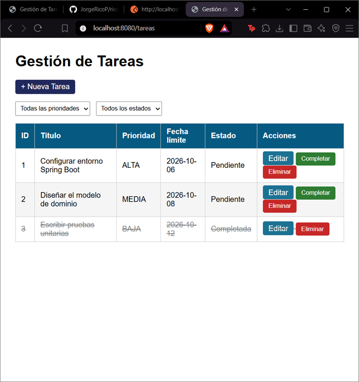
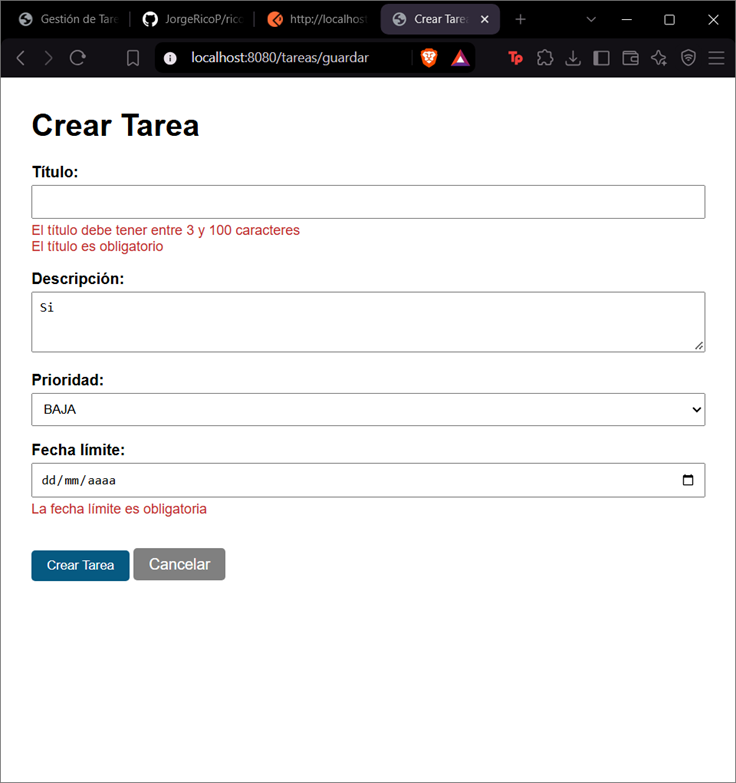
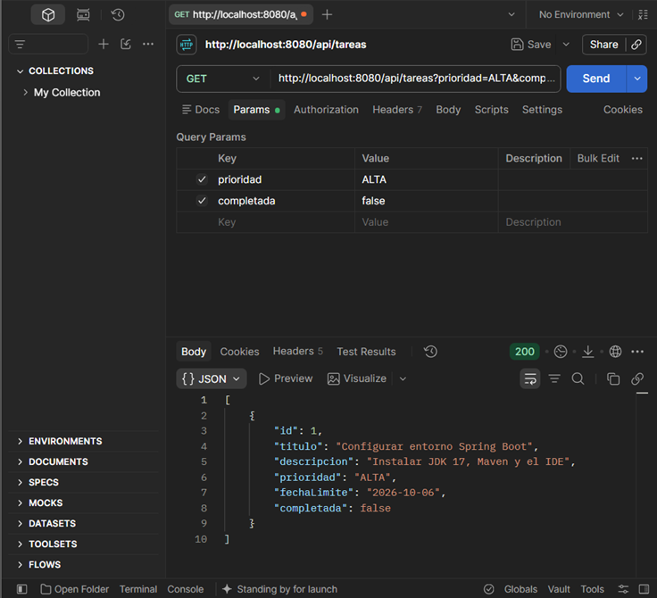
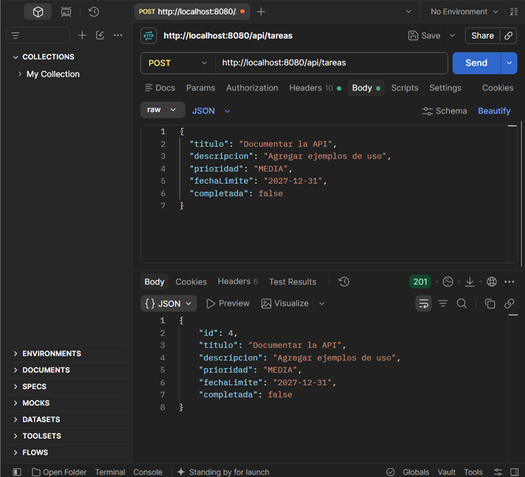
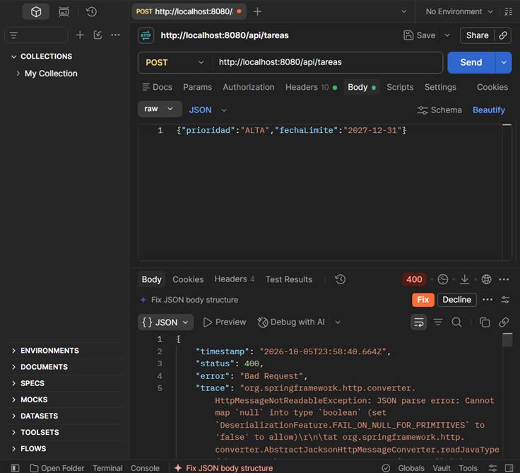
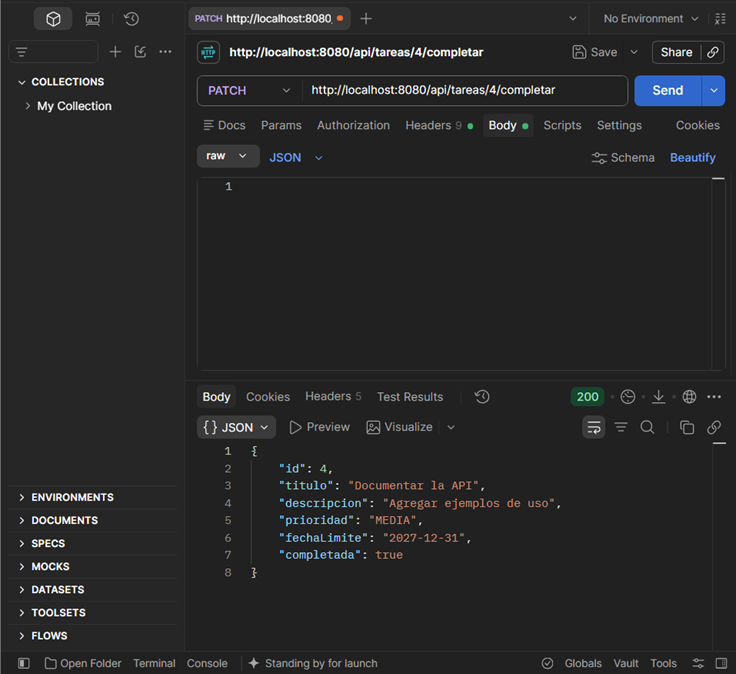
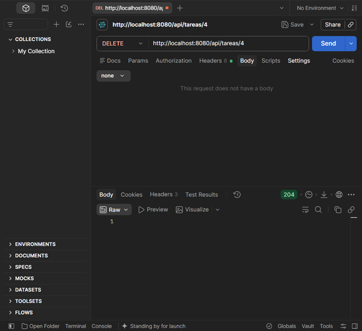
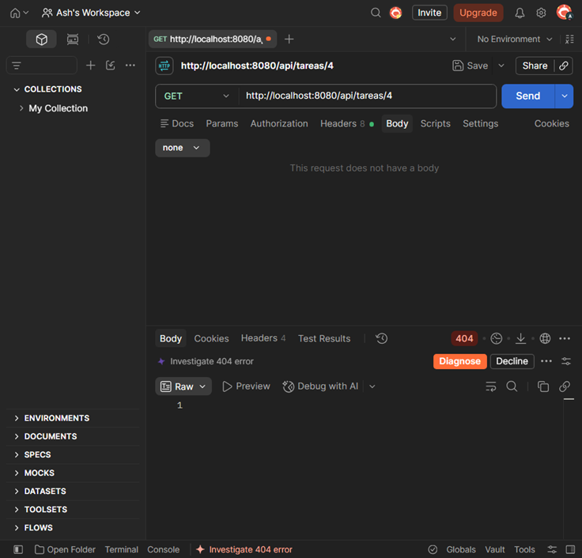
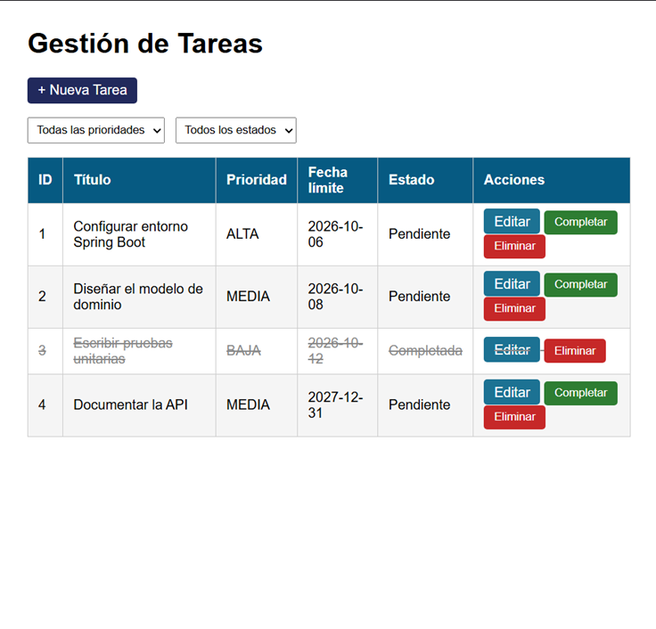

# Post-contenido — Unidad 7: Gestión de Tareas con Spring Boot

**Autor:** Jorge Rico

## Descripción
Repositorio del laboratorio de la Unidad 7 de Programación Web — Séptimo
Semestre. Un único proyecto Spring Boot con dos capas sobre el mismo
TareaService: una vista Thymeleaf (@Controller, parte 1) y una API REST
(@RestController, parte 2).

## Parte 1 — Vista Thymeleaf con @Controller
TareaController expone /tareas con filtrado por @RequestParam (prioridad,
completada), formularios validados con @Valid + BindingResult, y las
acciones completar/eliminar implementadas como POST (no GET) para no
introducir efectos secundarios en peticiones de solo lectura.

## Parte 2 — API REST con @RestController
TareaApiController expone /api/tareas con los verbos GET, POST, PUT,
PATCH y DELETE, inyectando por constructor la MISMA instancia de
TareaService que usa la Parte 1. ApiErrorHandler traduce los errores de
@Valid en JSON estructurado (400 Bad Request), en lugar de la pantalla
de error HTML por defecto de Spring Boot.

### Endpoints de la API

| Método | URL | Éxito | Error | Descripción |
|---|---|---|---|---|
| GET | `/api/tareas` | 200 OK | — | Lista de tareas, filtrable con `?prioridad=` y/o `?completada=` |
| GET | `/api/tareas/{id}` | 200 OK | 404 Not Found | Retorna la tarea con el ID indicado |
| POST | `/api/tareas` | 201 Created | 400 Bad Request | Crea una tarea; 400 si falla la validación |
| PUT | `/api/tareas/{id}` | 200 OK | 404 / 400 | Reemplaza todos los campos de la tarea |
| PATCH | `/api/tareas/{id}/completar` | 200 OK | 404 Not Found | Actualización parcial: marca `completada = true` |
| DELETE | `/api/tareas/{id}` | 204 No Content | 404 Not Found | Elimina la tarea |

## Decisiones de diseño
- Inyección por constructor (no @Autowired en campo) en ambos
  controladores: mejora la testabilidad y hace explícita la dependencia.
- @FutureOrPresent en lugar de @Future en fechaLimite: permite tareas
  con vencimiento el mismo día de su creación.
- POST (no GET) para completar/eliminar en TareaController: una petición
  GET debe ser segura y no debe modificar estado del servidor.
- PATCH (no PUT) para /api/tareas/{id}/completar: representa una
  actualización parcial de un único campo, no el reemplazo del recurso.
- Manejo de validación separado por capa: BindingResult para la vista
  HTML, @RestControllerAdvice para la API JSON — cada una responde en el
  formato que le corresponde.
- Persistencia en memoria (Map en TareaService) en lugar de JPA/Hibernate:
  la persistencia real se introduce formalmente en la Unidad 8.
- Campo oculto `completada` en formulario.html: evita que editar una tarea
  ya completada la devuelva a estado pendiente.
- `crear` en la API ignora cualquier `id` enviado en el JSON: el servidor
  asigna el ID, así un POST nunca sobrescribe una tarea existente.

## Cómo compilar y ejecutar
1. Clonar el repositorio: `git clone https://github.com/JorgeRicoP/rico-post1-u7-proweb`
2. Abrir la carpeta como proyecto Maven en IntelliJ IDEA
3. Ejecutar `mvn spring-boot:run` (o `./mvnw spring-boot:run`)
4. Vista web: http://localhost:8080/tareas
   API REST: http://localhost:8080/api/tareas (probar con Postman o curl)

## Capturas de pantalla

